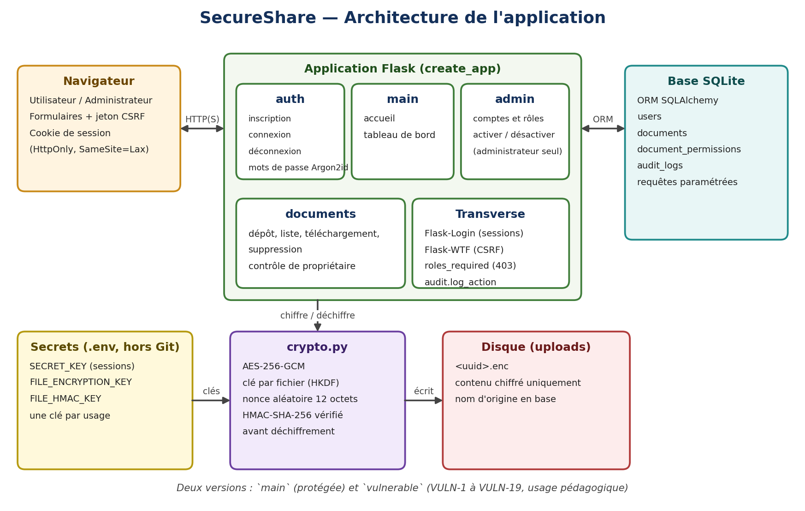

# Open-source Anti-DDoS architecture on Red Hat Enterprise Linux

Prevention, detection and automatic blocking of application-layer abuse (HTTP floods, scans) using **Nginx, Docker, CrowdSec, nftables, Prometheus/Grafana, AIDE and OpenSCAP**, documented with an **ISO/IEC 27001:2022** audit approach.

> Academic project (Audit ISO/IEC 2700x, TEK-UP University, 2026). Built and tested in an isolated lab, on my own virtual machines only.



## What it does

- **Single entry point**: all traffic goes through Nginx; the web application runs in a Docker container published on `127.0.0.1:8080` only.
- **Rate limiting**: 10 requests/s per IP (burst 20), 20 concurrent connections per IP, short timeouts, HTTP 429 on excess.
- **Detection and blocking**: CrowdSec reads the Nginx logs, raises an alert and a ban decision; the nftables bouncer drops the banned IP's packets before they reach Nginx.
- **Host hardening**: SSH key-only, root login disabled, restricted firewall, kernel anti-SYN-flood settings, SELinux Enforcing, login banner, sudo logging, AIDE file integrity.
- **Monitoring**: Prometheus + Node Exporter + Grafana, bound to localhost (Grafana via SSH tunnel).
- **Compliance evidence**: OpenSCAP scans (CIS Level 1 Server profile) before and after hardening.

## Measured results

| Test | Result |
|---|---|
| 100 parallel requests from the client | 22 x `200` and 78 x `429` (second run: 23 / 77) |
| Backend exposure | Port 8080 unreachable from the client (timeout); listens on `127.0.0.1` |
| Detection and blocking | CrowdSec alert `nginx-req-limit-exceeded`, ban decision; client gets `200` at 17:09:17 then timeouts from 17:09:22 |
| OpenSCAP (CIS L1 Server) | 157 -> 167 passed rules, 118 -> 108 failed, 20 not applicable |
| AIDE | Baseline of 191,856 entries |

Ban duration was reduced from 4 h to 2 min for the lab demo.

## Repository structure

```
configs/     Nginx, sysctl, SSH and CrowdSec configuration
webapp/      Docker Compose file and test page
monitoring/  Prometheus, Node Exporter and Grafana (Compose)
docs/        Report, slides, architecture diagram, screenshots
preuves/     Text outputs of the tests and scans
```

## How to reproduce (summary)

1. RHEL 9 VM, updated (`dnf update`), with `firewalld`, `audit`, `chrony`, `openscap-scanner`, `scap-security-guide`.
2. SSH: create an ed25519 key, **test key login in a second session**, then copy `configs/00-hardening.conf` to `/etc/ssh/sshd_config.d/` and run `sshd -t && systemctl restart sshd`.
3. Firewall: allow `http`/`https`, allow `ssh` only from your admin IP (rich rule), remove other services.
4. Kernel: copy `configs/99-anti-ddos.conf` to `/etc/sysctl.d/` and run `sysctl --system`.
5. Docker (official repository) and `docker compose up -d` in `webapp/`.
6. Nginx: copy `configs/anti-ddos.conf` to `/etc/nginx/conf.d/`, disable the default `server` block in `nginx.conf`, then `setsebool -P httpd_can_network_connect 1`.
7. CrowdSec: install the engine, move the local API to port 8081 (8080 is used by the app), install `crowdsecurity/nginx`, declare the Nginx log files in `acquis.d`, enable the `dateparse-enrich` parser, install `crowdsec-firewall-bouncer-nftables`.
8. Monitoring: copy `monitoring/.env.example` to `monitoring/.env`, set `GF_PASSWORD` (never commit it) and run `docker compose up -d`.
9. AIDE (`aide --init`) and OpenSCAP (`oscap xccdf eval --profile xccdf_org.ssgproject.content_profile_cis_server_l1 ...`).

## ISO/IEC 27001:2022 mapping

| Risk | Measure | Control |
|---|---|---|
| HTTP flood | Nginx rate limiting | A.8.6 |
| Network abuse | firewalld, sysctl, backend on localhost | A.8.20, A.8.22 |
| Unauthorized host access | SSH keys, AllowUsers, SELinux | A.8.5 |
| Late incident detection | CrowdSec, Prometheus, AIDE | A.8.16 |
| Lack of traceability | Nginx logs, sudo log | A.8.15 |
| Configuration drift | Backups, snapshots, OpenSCAP | A.8.9, A.8.8 |

## Limits

- A local VM **cannot stop a volumetric DDoS** that saturates the Internet link; upstream protection (ISP, CDN/WAF, scrubbing) is required in production.
- Tests come from a single source IP; a real attack is distributed.
- Built on RHEL 9.8 (the commands are equivalent on RHEL 10).
- 167 of 275 applicable CIS rules pass; remaining gaps are documented in the report (accepted, postponed or to do).

## Lessons learned

- Docker bypasses firewalld for published ports: binding to `127.0.0.1` is what really isolates the backend.
- With SELinux Enforcing, Nginx needs `httpd_can_network_connect` to reach the container.
- CrowdSec read the logs but parsed nothing until `dateparse-enrich` was enabled; `cscli explain` made the problem visible.
- A hardening file in `sshd_config.d/` must sort before defaults (`00-`), and a contradicting default file must be removed.

## Author

Rayen Sliti, final-year engineering student in Cybersecurity & Networks, TEK-UP University.
